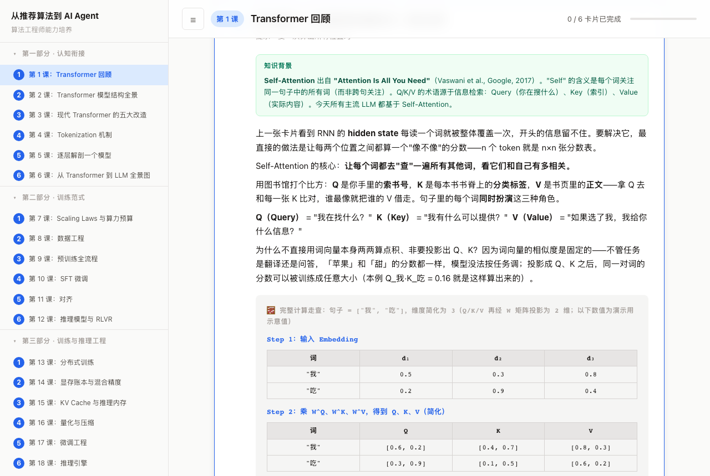

# 从推荐算法到 AI Agent

> 一套写给**传统算法工程师**的大模型课程：34 课，每课 6 张卡片，每张卡片从一个问题出发，用一组具体数字把机制从头算一遍。
> 既是我自己的学习笔记，也想分享给同样要补大模型知识的人，**欢迎提意见**。

**在线阅读：<https://zhuangzhaoyeye.github.io/llm-course/>**（单页、免登录、手机可看）



---

## 为什么做这个项目

我是做推荐算法的。转向大模型时遇到的问题不是资料太少，而是：

- 教程遍地，ArXiv 每天几十篇，**读过 ≠ 会用**；
- 看完 Self-Attention 的讲解，合上页面却推不出来，也说不清"没有 Q/K/V 会怎样"；
- 每学一个新点都要自己去翻论文、问 AI、交叉核对，**花在找资料上的时间比学的时间还长**。

所以这个项目有两个目标：

1. **自用 + 分享**：把"算法工程师学大模型"这条路径上的东西整理成一套能直接顺着读的课程，让大家不用再各自找论文、问 AI、核对数字。
2. **长期探究**：能不能让 **AI 一键生成质量过关的课程**？课程本身既是产品，也是这个问题的实验场——下面"课程是怎么生成的"一节会如实说明做到了哪一步、哪里还不行。

唯一的验收判据：**学完 Self-Attention，你能不能在白板上拿一句话、几个向量，从头手算一遍？能不能告诉同事"如果没有 Q/K/V 你会用什么替代、效果差在哪"？**

---

## 课程内容

| 部分 | 课号 | 主题 |
|---|---|---|
| 一 · 认知衔接 | 1–6 | Transformer 回顾、模型结构全景、现代 Transformer 的五大改造、Tokenization、逐层解剖一个模型、从 Transformer 到 LLM 全景图 |
| 二 · 训练范式 | 7–12 | Scaling Laws 与算力预算、数据工程、预训练全流程、SFT、对齐、推理模型与 RLVR |
| 三 · 训练与推理工程 | 13–19 | 分布式训练、显存账本与混合精度、KV Cache 与推理内存、量化与压缩、微调工程、推理引擎、大模型评测 |
| 四 · Agent 工程 | 20–28 | 提示工程、从 Prompt 到 Agent、工具调用、MCP 协议、记忆与 RAG、规划与反思、多智能体与协议、Agent 训练、Agent 评测与生产化 |
| 五 · 自主研究 | 29–34 | 自主研究全景与自主度分级、文献锚定与选题、假设规划与搜索、长时程执行与状态、验证复现与评审、报告成本与责任 |

每课 6 张卡片，每张卡片带 5 条以上的预设追问，答案同样带表格和数字。

---

## 课程设计：第一性原理 + 因果链

这套课程不是"知识点清单"，而是按下面三条底色写的。

### 1. 因果链替代知识树

| | 传统教法 | 本课程 |
|---|---|---|
| 开场 | "今天学 Self-Attention，它是 RNN 的优化" | "RNN 传 50 步后梯度只剩 0.5%，怎么让每个词直接看到所有词？" |
| 路径 | 分类 → 定义 → 公式 → 结论 | 问题 → 撞墙 → 尝试 → 再撞墙 → 逼出解法 |
| 你得到 | 记住层级关系 | 理解"为什么会需要它" |

分类是专家**回顾**时的视角，不是**学习**时该走的路。你还没遇到"RNN 处理长句会丢信息"，就被告知"Self-Attention 解决了长距离依赖"，这对你只是一条信息，不是一个领悟。

### 2. 第一性原理

- **不从"业界怎么做"讲起，从"为什么必须这样"讲起。** 每个设计都还原到它要解决的原始矛盾。
- **禁止把结论当公理。** "除以 √d_k 可以稳定训练"不算讲完，必须给后果：不除时 d_k=64 的点积标准差约 8，softmax 趋于 one-hot，梯度趋零。
- **禁止用"业界通常 / 惯例如此 / 实践证明"当理由。**
- **推理链的起点是任务约束，不是"旧方案不行"。** 每课有一条 6 步推理链，要求：每步之间是"导致 / 要求 / 在什么条件下会破"的关系；只看 6 个节点能在白纸上复述；不允许"正交插入"（上一步讲 A，下一步讲 B，B 并不是 A 逼出来的）。

### 3. 每张卡片的五阶段骨架

```
激活 → 锚定 → 推导 → 升华 → 追问
```

| 阶段 | 做什么 |
|---|---|
| 激活 | 先抛一个场景化问题，让你自己想 30 秒；提示只给方向，不给答案 |
| 锚定 | 标出论文、作者、年份、当时要解决的痛点 |
| 推导 | **用最小的真实例子把机制跑一遍**：句子"我吃"、2 个词、3 维，从 Q×K^T 一路算到加权 V，每步一个标题、一张表，无魔法常数 |
| 升华 | 展示冲突：有 X → 结果 A，没有 X → 结果 B，让你看到代价 |
| 追问 | 你下一步最想问的问题已备好答案，带数字；也可以直接问卡片内的 AI 助教 |

另外两条硬规则：**每个新术语首次出现必须紧跟白话定义**；**术语是主体，类比只是脚手架**（类比后必须回到专业名词，否则你读不了论文和代码）。

---

## 课程是怎么生成的（技术架构）

### 一、产物与源码

课程交付物是**一个自包含的 HTML 文件**（KaTeX 已内联，无 CDN，可离线打开）。

```
src/lessons/manifest.json     课程映射表，唯一事实源（id = 课号）
src/lessons/lesson-<id>.html  每课正文（纯 HTML 片段，不手写转义）
src/shell.html                页面骨架 + 样式 + 全部 JS + AI 助教 + 部分课的追问数据
src/assets/                   KaTeX 的 CSS / JS（构建时内联）
scripts/build.py              组装：按 manifest 把每课正文 JSON 转义后填进 shell，内联 KaTeX
dist_course.html              构建产物，禁止手改
```

设计取舍：不用前端框架、不引入构建链，改完即可看；单文件意味着拿到一个文件就能学。`build.py --check` 会校验产物与源码是否一致，并保证产物里没有外部资源引用。

### 二、生成流水线

每次新增或改动内容，走同一条流水线：

```
联网检索 → 设计推理链 → 写卡片(五阶段) → 逐条核验 → 机械门禁 → 独立盲审 → 差集/漏检率 → 构建发布
```

| 环节 | 做什么 |
|---|---|
| 联网检索 | 每轮先搜再答。涉及"某篇论文做了什么"，先查一手来源再动笔，禁止凭模型记忆 |
| 设计推理链 | 先在纸面按因果链排 6 个问题，再写卡片 |
| 逐条核验 | **范围 = 每个主问题 + 每条追问，不抽样**。每条断言先归类，再交给对应裁判（见下表），记入 9 列台账 |
| 机械门禁 | 脚本只管"有唯一答案"的事：结构、覆盖度、台账是否过期、渲染 |
| 独立盲审 | 另起一个**信息隔离**的审阅者（不许读我方台账），分"事实与算术""语义与逻辑"两路 |
| 差集 | 盲审独有的缺陷 = 我方漏检，必须补进台账；漏检率必须是显式数字 |

**断言按类型路由，不是"全部丢给 python"：**

| 类型 | 裁判 | 举证要求 |
|---|---|---|
| 算术 | `python3` 独立复算 | 给出可复算的算式 |
| 事实 | 联网 + 一手来源 | 给链接，或写明"未找到" |
| 推导 | 反例 + 边界检验 | 写出边界条件或反例 |
| 经验数字 | 无裁判，只能标注 | 无一手来源只能标"估算"，不得判通过 |
| 语义 | 只有人 | 写明所依据的规则条款 |

### 三、门禁

| 脚本 | 判什么 |
|---|---|
| `tools/content_verify.js` | 每卡 7 大组件、div 配平、数字门禁、追问条数、桥接句、类比配额、标题四处一致 |
| `tools/verify.js`（Playwright） | 布局重叠、溢出、对比度、768px 响应式、切课、控制台报错 |
| `tools/review_check.js` | 台账覆盖度、断言覆盖（漏列一条断言就 FAIL）、类型路由、盲审是否做过 |
| `tools/provenance_check.js` | 台账时效性：内容改过而台账未重核验 → FAIL |
| `tools/coverage_check.js` | 覆盖地图归档与领域锚点是否落地 |
| `tools/crossscope_check.js` | 跨课数值口径一致（同一量在不同课只能取同一值） |
| `tools/gate.js` | 开工闸门：以上任一未清，只允许清账，不允许写新内容 |

交付标准：**0 FAIL 且 0 WARN**。每修完一个问题，追问一句"下次怎么自动拦住它？"，能写成脚本的当场写进去。

### 四、AI 助教

- 每张卡片内嵌一个对话面板，系统提示注入**本卡完整内容**（问题 + 正文 + 计算块），不是整课。
- 约束三条：优先用具体数字例子、纠正可能的误解、不确定的诚实说明不编造。
- 前端直连 DeepSeek（Anthropic 兼容接口，支持联网搜索）。**站点不内置任何密钥**：首次提问时在弹框里填你自己的 key，只存在你浏览器的 localStorage，请求直接发往 DeepSeek，不经过任何中转服务器。

---

## 目前做到了哪一步，哪里还不行

**这还不是"AI 一键生成好课程"。** 如实记录几个数字：

- 机械门禁全绿的时候，我对第 1–28 课做过一轮**独立盲审**（8 路并行、两视角、逐条联网），仍然查出 **186 条缺陷**（P0 10 条、P1 36 条）。
- 其中**算术 0 处误算**——门禁和复算确实守住了算术与结构。
- 缺陷集中在门禁原本不管的四类：**推理链正交插入**、**提示泄题 / 主问题预设结论**、**跨课口径冲突**、**正文里没有一手来源的读数**。
- 第 1 课我方自查的**漏检率是 29%**（独立盲审 31 条里我漏了 9 条）。
- 盲审本身也会漏，且与生成方常是同族模型，**能发现"认真点就能看见的错"，发现不了"我们都不知道的错"**。

所以现在的结论是：**脚本能守住有唯一答案的事（算术、结构、覆盖度），语义和品味判断仍然需要人。**"一键生成"离可用还有距离，这正是我想继续探究的部分。

### 想听你的意见

- 你读完一张卡片后，能不能真的在白板上推出来？卡在了哪一步？
- 哪些地方的"类比"帮到了你，哪些反而干扰了你？
- 你发现的错误：数字、论文归属、版本、口径不一致。
- 推理链的顺序是否自然？有没有"这一步为什么接这一步"想不通的地方？
- 对"让 AI 生成高质量课程"这件事，你觉得缺的是什么：更强的模型、更好的评审、还是人在回路里？

**提意见的方式：到本仓库开 [Issue](../../issues)。** 麻烦写清位置，例如"第 4 课第 2 张卡片，追问 3"，并附上你认为不对的原文和理由，我会逐条核实。不需要会写代码。

---

## 本地构建

```bash
python3 scripts/build.py          # 生成 dist_course.html（只需 Python 3，无第三方依赖）
python3 scripts/build.py --check  # 校验产物与源码一致
node tools/content_verify.js --src   # 内容层门禁（零依赖）
npm install && npx playwright install chromium && node tools/verify.js   # 渲染层
```

**关于校验脚本的可运行范围**：`review_check.js`、`provenance_check.js`、`coverage_check.js` 依赖作者本地的逐条核验台账与覆盖地图，这些未随仓库公开，克隆后无法运行，仅供参考其校验思路。`build.py`、`content_verify.js`、`verify.js` 在干净克隆里实测可直接运行。

## 目录

| 路径 | 内容 |
|---|---|
| `src/` | 课程源码：`lessons/`（34 课正文 + manifest）、`shell.html`、`assets/` |
| `scripts/` | 构建脚本 |
| `tools/` | 校验脚本 |
| `.trae/rules/` | 课程设计方法论与内容规则（上面"课程设计"一节的完整版） |
| `.trae/skills/` | 生成、质检、盲审、构建的操作流程（给 AI 助手读的 SKILL） |

## 许可

暂未指定许可证，默认保留所有权利。如需转载或二次使用，请先开 Issue 联系我。
